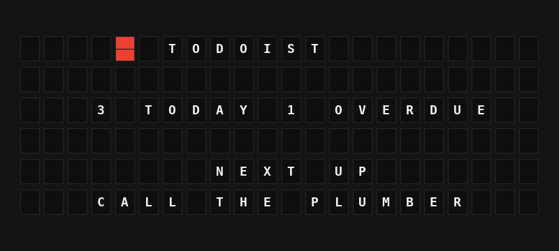

# Todoist Plugin

Show what's on your Todoist plate: tasks due today, overdue tasks, and the next task to do.



**→ [Setup Guide](./docs/SETUP.md)**

## Overview

The Todoist plugin asks the Todoist API for your tasks matching `today | overdue` and turns them into board-ready variables: how many are due today, how many are overdue, a one-line summary, a colour status tile, the next task to do, and a short list of tasks.

Connect with the **Sign in with Todoist** button: there is no app to create, no client ID to copy and no secret to enter, and FiestaBoard keeps the sign-in fresh. If you prefer, paste a personal API token instead. Requires FiestaBoard 9.8.0 or later.

## Template Variables

### Counts

| Variable | Description | Example |
|----------|-------------|---------|
| `{{todoist.due_today}}` | Tasks due today (not counting overdue ones) | `3` |
| `{{todoist.overdue}}` | Tasks due before today | `1` |
| `{{todoist.due_total}}` | Due today plus overdue | `4` |
| `{{todoist.summary}}` | Counts on one line, or `ALL CLEAR` | `3 TODAY 1 OVERDUE` |
| `{{todoist.status_tile}}` | Red when something is overdue, yellow when tasks are due today, green when clear | `{63}` |
| `{{todoist.all_clear}}` | Nothing due today and nothing overdue | `false` |

### Next Task

| Variable | Description | Example |
|----------|-------------|---------|
| `{{todoist.next_task}}` | The oldest overdue task, then today's tasks by time and priority | `CALL THE PLUMBER` |
| `{{todoist.next_task_due}}` | `OVERDUE`, `TODAY`, or a time like `3:30 PM` | `OVERDUE` |
| `{{todoist.next_task_priority}}` | Priority as Todoist shows it, `P1` (urgent) to `P4` | `P1` |

### Task List

Up to 10 tasks, in the same order as the next task: `{{todoist.tasks.0.content}}` through `{{todoist.tasks.9.content}}`.

| Field | Description | Example |
|-------|-------------|---------|
| `content` | Task name | `WATER THE FERNS` |
| `due` | `OVERDUE`, `TODAY`, or a time | `8:30 AM` |
| `priority` | `P1` to `P4` | `P4` |

## Example Templates

### Summary and next task

```
{{todoist.status_tile}} TODOIST

{{todoist.summary}}

NEXT UP
{{todoist.next_task}}
```

### Task list

```
{{todoist.status_tile}} {{todoist.summary}}
{{todoist.tasks.0.content}}
{{todoist.tasks.1.content}}
{{todoist.tasks.2.content}}
{{todoist.tasks.3.content}}
```

### Note

```
{{todoist.status_tile}} TODOIST
{{todoist.due_today}} TODAY {{todoist.overdue}} LATE
{{todoist.next_task}}
```

## Configuration

| Setting | Description | Default |
|---------|-------------|---------|
| `enabled` | Turn the plugin on | `false` |
| `api_key` | Personal API Token (optional). Used only when you are not signed in. | empty |
| `timezone` | IANA time zone that decides what counts as today. Empty uses the board's time zone. | empty |
| `refresh_seconds` | How often to ask Todoist, 60 to 3600 seconds | `300` |

The sign-in itself is in the plugin's **Account connection** section. It requests the read-only `data:read` scope.

## Features

- Sign in with Todoist, with no app to register (FiestaBoard is a public client using a client ID metadata document and PKCE)
- Personal API token as an alternative to signing in
- Counts of tasks due today and overdue, and a colour status tile
- The next task to do, with its due time and priority
- A list of up to 10 tasks for multi-line templates
- Task names cleaned for the board: Markdown links reduced to their text, accents folded, emoji dropped
- Reads up to 1,000 matching tasks, following the API's pagination
- Honours Todoist's `Retry-After` on rate limits, and keeps showing the last tasks through short outages

## Author

FiestaBoard Team
